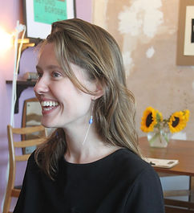

# about

I'm Isabel, a qualified Art Therapist and Workshop Leader based in Valencia, helping people find their voice through creativity, play and authentic expression.

## Education

Masters in Art Therapy, Metàfora, Barcelona, 2023–2025

Postgraduate in Art Therapy, Metàfora, Barcelona, 2022

Upper Second Class in BA (Hons) Illustration, Camberwell College of Arts London, 2014–2017

Academie Royale des Beaux Arts, Brussels, 2015–2016

UAL Foundation diploma in Art and Design, Stockport College, 2014–2015
